<div align="center">

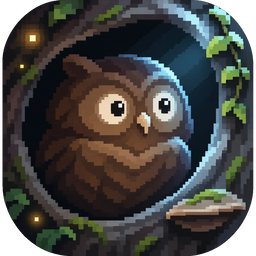

# NIGHTFALL

**A living night forest in your terminal.**

Procedural pixel-art woodland drawn with Unicode half blocks and true colour.<br>
Creatures with their own intentions wander in, climb, hide, play, chase and fall asleep.<br>
Every scene is different. A frame takes about half a millisecond.

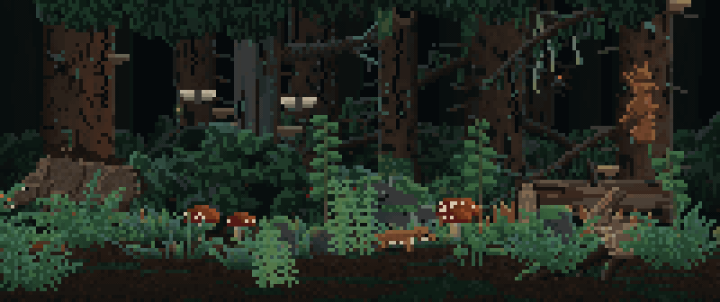

[](https://github.com/mrkuko/nightfall/actions/workflows/ci.yml)
[](https://github.com/mrkuko/nightfall/releases)


[](LICENSE)

</div>

---

## Features

- **Procedural scenes.** A seed picks a biome and a composition (a giant tree on the side, a grove,
  a clearing, a thicket …). Then it grows dozens of unique trees, stumps, logs, bushes, ferns, mushrooms
  and stones, scattered in depth. No two scenes are the same.
- **Real depth.** Every pixel carries its own depth. A per-pixel z-buffer compositor puts the fox's far
  legs behind its body and the grass in front of it. It hides a rabbit inside a bush except where
  the leaves part, and shows a squirrel in a hollow only through the opening.
- **Creatures with intentions.** 25 creatures: rabbits, squirrels, foxes, owls, bats, deer, boars,
  badgers, dholes, moles, fireflies and more. Each has drives (hunger, fatigue, boredom, fear) and picks
  intents: forage, climb a tree along a real path, roost in a hollow, hang under a branch, hide in a bush,
  peek out, chase out of curiosity, play with the pack, sleep. An owl may spot a mouse from its hollow, glide
  over, stoop and either catch it and fly off with it in its talons, or miss.
- **Living weather.** Gusts of wind roll through the grass from one side, with calm in between, and each
  plant is a damped spring that sways as a gust passes. An animal walking through bends only the plants it
  actually brushes against. Moonbeams, drifting mist and glowing fungi.
- **Biomes.** Oak wood, beech hall, spruce taiga, rocky pine wood, birch grove, alder swamp, mixed forest.
  Each has its own trees, undergrowth, animals and ground (needles, moss, mud, gravel …).
- **Tiny and fast.** One ~500 kB binary with all art compiled in. Plain C99 with libc and libm only
  (no ncurses). About 0.4 ms per frame and a diff renderer with one `write()` per frame.
- **Moddable.** Shapes and animations live in a plain-text `.spr` format you can draw in any editor.
  Load them from a folder and hot-reload them in the gallery.

## Screenshots

| | |
|:---:|:---:|
| 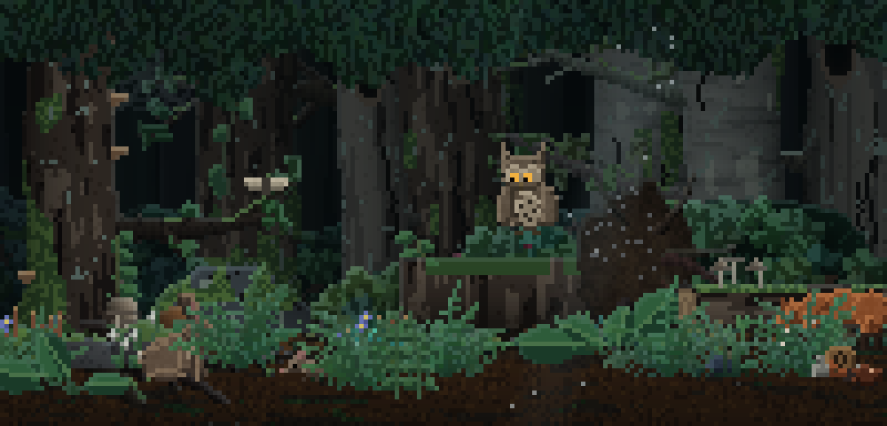<br>**Oak wood** | 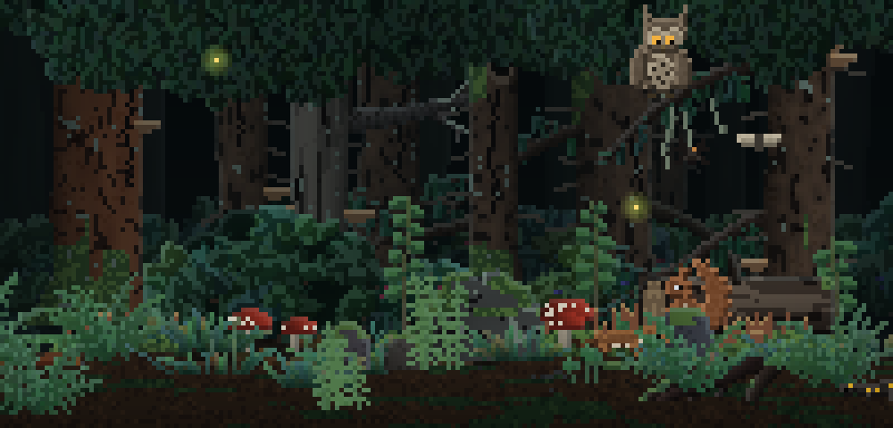<br>**Spruce taiga** |
| 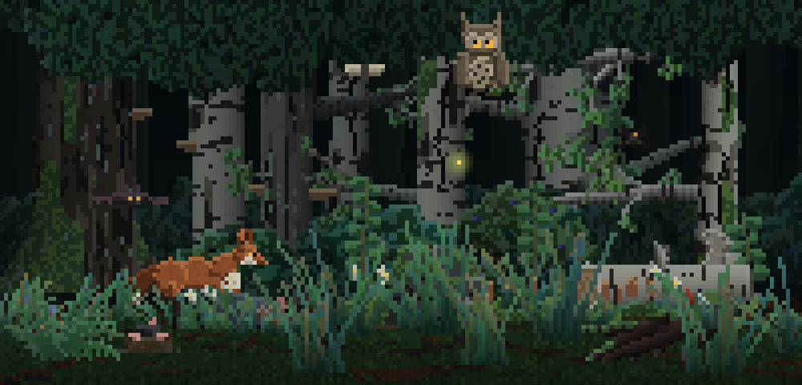<br>**Birch grove** | 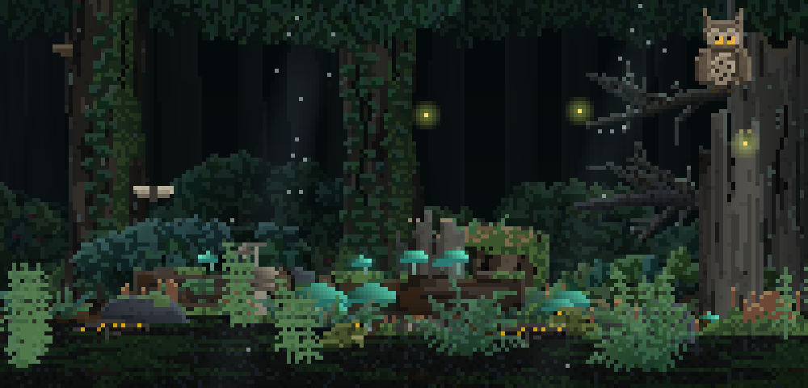<br>**Alder swamp** |
| 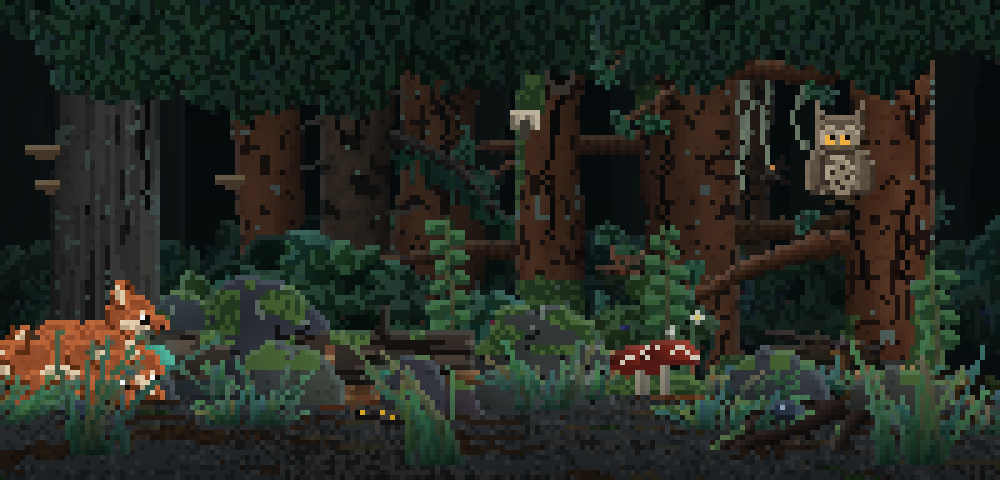<br>**Rocky pine wood** | 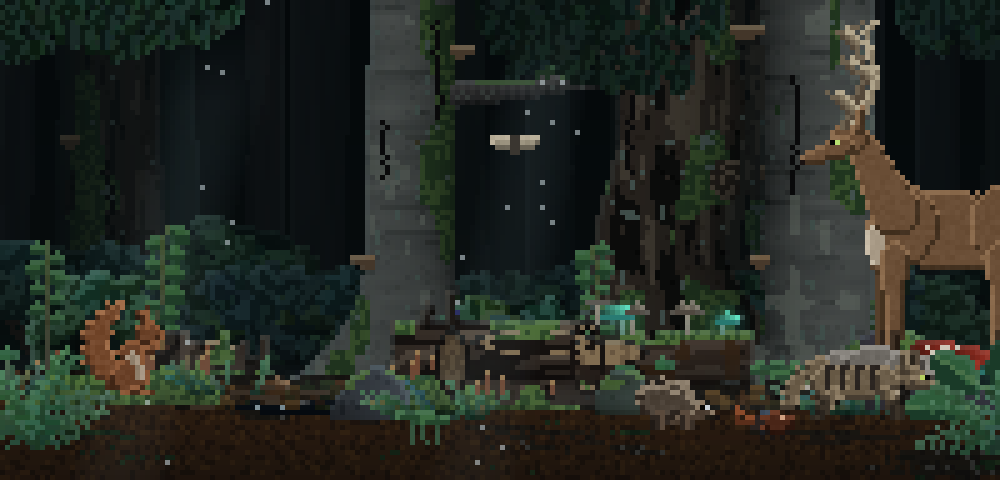<br>**Beech hall** |

| | | |
|:---:|:---:|:---:|
| 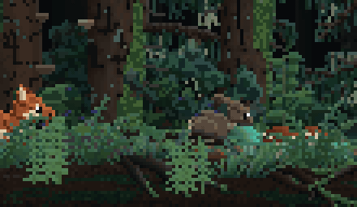<br>A dhole pack plays and chases | 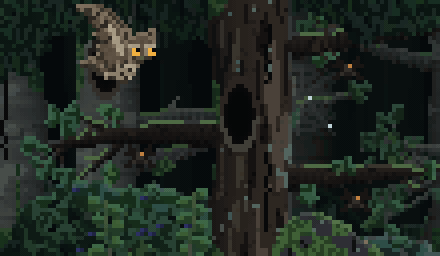<br>An owl roosts in a hollow | 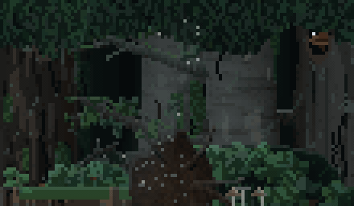<br>A squirrel climbs, peeks out |
| 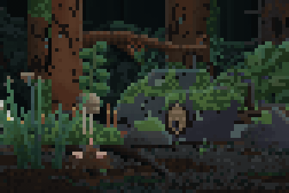<br>A mole leaves molehills | 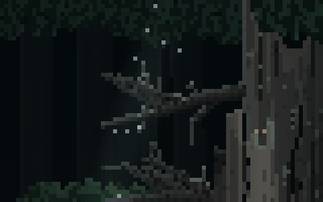<br>A bat hangs under a branch | 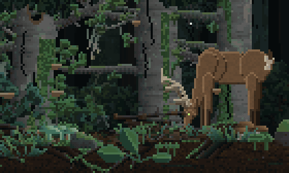<br>A deer grazes in the wind |

## Install

### Downloads

Everything is on the [releases page](https://github.com/mrkuko/nightfall/releases) and installs
offline. The Linux builds are static, so they have no dependencies.

| System | File | Install |
|---|---|---|
| Debian, Ubuntu | `nightfall_*_amd64.deb` / `arm64.deb` | `sudo apt install ./nightfall_*.deb` |
| Fedora | `nightfall-*.x86_64.rpm` / `aarch64.rpm` | `sudo dnf install ./nightfall-*.rpm` |
| Arch Linux | `nightfall-*.pkg.tar.zst` | `sudo pacman -U nightfall-*.pkg.tar.zst` |
| any Linux | `nightfall-*-linux-*.tar.gz` | unpack and run `nightfall` |
| macOS | `nightfall-*-macos-universal.tar.gz` | unpack and run `nightfall` |
| Windows | `nightfall-*-windows-x86_64.zip` | unpack and run `nightfall.exe` in Windows Terminal |

Versions: **`vX.Y.0` is a full release**; `vX.Y.Z` with `Z` above 0 is a **nightly build**, marked as a
pre-release on the releases page.

### From source

All you need is a C99 compiler and `make`.

```sh
git clone https://github.com/mrkuko/nightfall
cd nightfall
make
./nightfall
sudo make install                   # optional: /usr/local/bin + man page (PREFIX=/usr, DESTDIR=… for packages)
```

**Windows:** build with [MSYS2](https://www.msys2.org/) (MinGW-w64):
`pacman -S make mingw-w64-x86_64-gcc`, then `make`. Run it in **Windows Terminal**. The classic
console host needs Windows 10 1809 or newer.

### Terminal requirements

- **True colour (24-bit)** and **Unicode**: kitty, Alacritty, WezTerm, foot, Ghostty,
  GNOME Terminal, Konsole, iTerm2, Windows Terminal …
- A font with the `▀` (upper half block) glyph. Practically every monospace font has one.
- A larger window means a bigger forest. The scene adapts to the terminal size and to resizing. In a
  very tall window (a 4K monitor with small text) the trees, the background trunks, the canopy and the
  moonbeams grow taller so that they reach beyond the top edge, and the trunks get more branches.

## Usage

```sh
nightfall                    # screensaver: watch, any key quits
nightfall --play             # playground: HUD, spawn animals, debug view
nightfall --gallery          # browse every shape and animation in the library
```

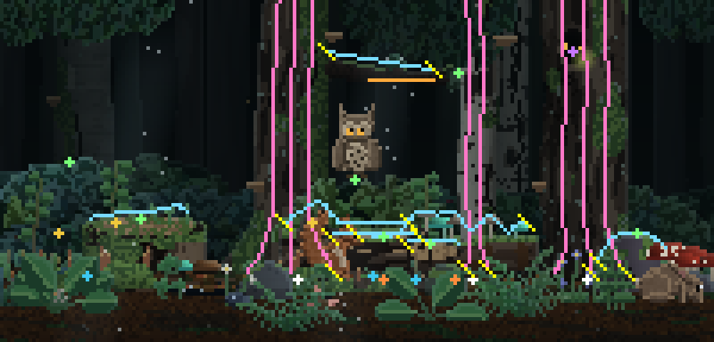

<sub>The debug view (`d`): pink = climbing lanes, blue = walkways, orange = hanging lines, yellow = links,
crosses = hideouts and perches. The playground also shows a HUD with every creature's current intent.</sub>

### Options

| Option | |
|---|---|
| `--seed N` | reproducible scene and behaviour |
| `--scene-time S` | compose a new scene every *S* seconds (`0` = never, default `600`) |
| `--biome auto\|off\|NAME\|list` | pick a biome (`auto`: by the seed, `off`: anything goes) |
| `--spawn-rate NAME=F …` | override spawn chances, e.g. `--spawn-rate dhole=0.3 rabbit=0` |
| `--grass-density F` | foreground plant density (default `1`) |
| `--grass-spread F` | randomness of the gaps between plants (`0` even … `2` clumpy) |
| `--grass-zspread F` | depth spread of the foreground (`0` one layer … `2` deep) |
| `--assets DIR` | load `.spr` files from a folder instead of the built-in ones |
| `--help`, `--version` | |

```sh
nightfall --biome taiga --spawn-rate dhole=0.4 owl=0.3
nightfall --seed 42 --scene-time 0 --grass-density 0.6
```

### Playground keys

| Key | | Key | |
|---|---|---|---|
| `q` | quit | `space` | pause |
| `l` | new scene | `+` / `-` | simulation speed |
| `B` | next biome | `n` | someone arrives now |
| `h` | toggle HUD | `d` | show places, paths, links |

Spawn a creature: `r` rabbit · `s` squirrel · `x` fox · `o` owl · `v` bat · `e` eyes ·
`g` spirit · `j` deer · `b` boar · `c` wildcat · `m` mole · `w` weasel · `p` dhole

### Gallery keys

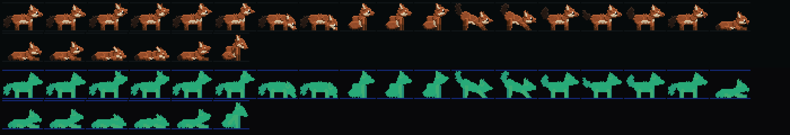

| Key | | Key | |
|---|---|---|---|
| `←` `→` | previous / next shape | `↑` `↓` | previous / next animation |
| `space` `.` `,` | pause, step, step back | `z` | zoom |
| `d` | depth view | `o` | grass in front of / behind |
| `f` `m` `b` | flip, walk, background | `p` | properties / profile |
| `s` | regenerate a procedural shape | `r` | reload assets (`--assets`) |

### As a real screensaver

```sh
# tmux: start the forest after 5 idle minutes
set -g lock-after-time 300
set -g lock-command "nightfall"
```

Any key returns you to your work. You can also bind it to a shell alias, a `swayidle`/`xautolock`
hook that opens a fullscreen terminal, or just leave it running on a second monitor.

## Biomes

| Biome | Trees | Ground | Typical visitors |
|---|---|---|---|
| Oak wood | oak, old oak, ivy oak, beech | leaf litter, soil, moss | rabbit, squirrel, badger, fox, deer, stag beetle |
| Beech hall | beech | deep leaf litter | squirrel, dormouse, owl, wildcat |
| Spruce taiga | spruce, pine | needles, moss | squirrel, owl, dhole, boar |
| Rocky pine wood | pine, dead pine | stone, gravel, sand | fox, weasel, wildcat, dhole |
| Birch grove | birch | grass, moss | rabbit, mole, hedgehog, deer, frog |
| Alder swamp | birch, dead trees | mud, moss, puddles | frog, salamander, snail, bat, fireflies |
| Mixed forest | a bit of everything | a bit of everything | anyone |

Biomes are plain data (`assets/biomes/biomes.spr`): weighted lists of trees, plants, animals and
floor patches. Add your own without touching the code.

## Creatures

| | | |
|---|---|---|
| **Rabbit** forages, grooms, freezes, bolts into a bush | **Squirrel** climbs trunks along real paths, runs out onto branches, hides in hollows | **Fox** trots, sniffs and hunts rabbits, mice and moles with a crouch and a pounce |
| **Owl** roosts in a hollow with only its eyes glowing and pokes its head out | **Bat** hangs upside down under branches | **Dhole** lives in packs, plays, chases out of curiosity, sleeps curled up |
| **Deer** grazes with its head down and blinks | **Mole** surfaces here and there and leaves molehills | **Hedgehog, badger, boar, wildcat, weasel, mouse, dormouse** |
| **Frog, salamander, snail, slug** | **Beetle, stag beetle, moth, fireflies, spider** | **Eyes in the dark, forest spirit** |

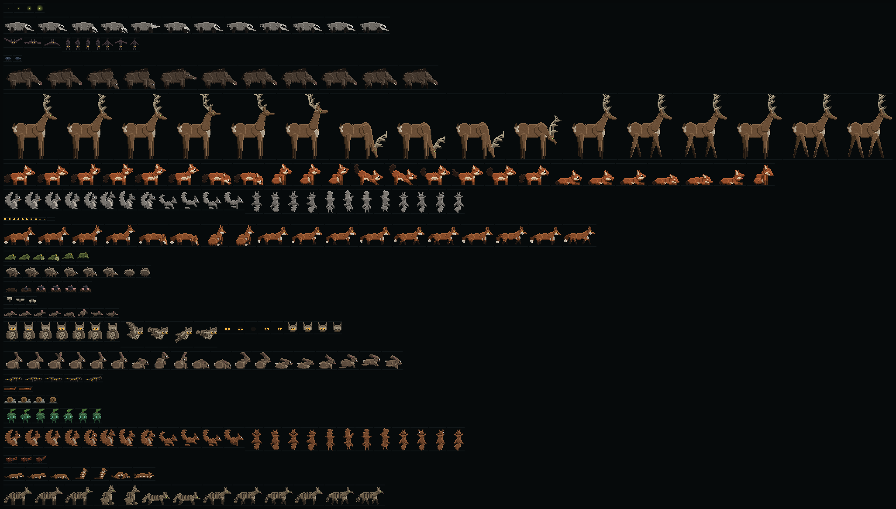

## How it works

- **Half-block raster.** Each terminal cell shows two square pixels with `▀` (foreground = top,
  background = bottom). A 200×50 terminal gives a 200×100 pixel canvas.
- **Depth compositor.** Every sprite pixel has a depth offset. Objects are blitted with a z-test into one
  buffer, with distance fog by depth. Static scenery is baked once, so each frame only copies it and
  draws what moves.
- **Diff renderer.** Only changed cells are written, inside synchronized-output brackets, in one
  `write()` per frame on the alternate screen.
- **Intents.** A small brain per creature: drives × profile weights × randomness pick an intent. The
  intent becomes a plan of steps (walk, climb a path, enter a hideout, peek, play an animation). Fear,
  noises and other creatures interrupt it.
- **Navigation.** Trees, branches, logs and boulders export climbing lanes, walkways and hanging
  lines. The world links nearby paths, so creatures can go from the ground up a trunk and out onto
  a branch.
- **Wind.** A slowly turning direction and travelling gust waves. Each plant is a damped spring.

## Make your own creatures

Shapes are text. Draw frames with palette keys, give each key a colour and a depth, and define
clips and a behaviour profile:

```text
sprite beetlet
tags creature ground tiny insect
anchor 5 4
palette
  b 3a4a2c ~4          # colour with a little noise
  B 3a4a2c ~4 z+1      # same colour, one step closer (near legs)
  g 1e2616 z-1         # far legs, behind the body
  e 0a0806
end
frame step0
|..bbbbb...
|.bbbbbbbe.
|.bbbbbbbbb
|..B.g.B.g.
|..........
frame step1 copy step0
patch 0 3
|..g.B.g.B.
clip walk loop fps=8 speed=6 : step0 step1
clip idle loop fps=2 : step0
creature
  move ground
  speed walk=6 run=14
  anim idle=idle move=walk
  intents wander=4 forage=3 hide=1
  homes log
end
end
```

```sh
nightfall --gallery --assets assets   # edit a file, press r to reload
```

The full format, including depth maps, frame patches, clips, transitions, paths, hollows and biomes, is
documented in [`assets/FORMAT.md`](assets/FORMAT.md). Many creatures are posed with a tiny optional
Python rig ([`tools/sketch_rig.py`](tools/sketch_rig.py)) that builds them from ellipses and capsules.

## Project layout

```text
src/          engine: terminal, raster + z-buffer, sprites, generators, world, creatures, scenes
assets/       creatures (.spr), biomes, FORMAT.md
tools/        embed.c (packs assets into the binary), sketch_rig.py (pose sketching)
docs/         man page, screenshots
packaging/    nfpm definition for the .deb / .rpm / Arch packages
```

## Contributing

Bug reports, new creatures, biomes and terminal compatibility notes are very welcome. Please keep it
C99 and dependency-free. `make CFLAGS="-std=c99 -Wall -Wextra -pedantic"` should stay warning-free.

### Regenerating the images

Every picture in this README is rendered by the program itself, headlessly (no terminal needed):

```sh
sh tools/make_screenshots.sh            # needs ImageMagick and ffmpeg
```

It uses `--snap`, `--record`, `--follow` and `--sheet`; see `nightfall --help`.

## License

MIT, see [LICENSE](LICENSE).

<div align="center"><sub>Inspired by <a href="https://robobunny.com/projects/asciiquarium/html/">asciiquarium</a>.</sub></div>
